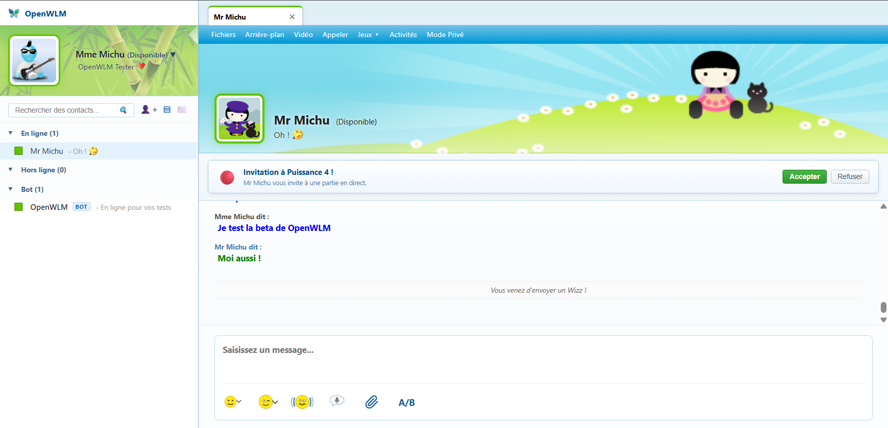
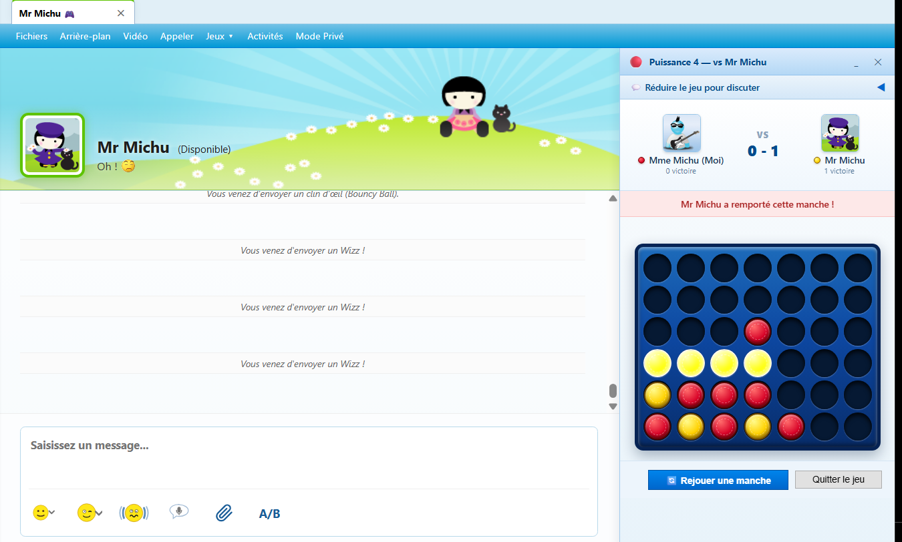

<p align="center">
  
</p>

<p align="center">
  <a href="README.md">English</a> • <b>Français</b>
</p>

# OpenWLM (Modern Web Stack)

Une recréation open-source d'une messagerie instantanée de la fin des années 2000 (interface Aero), avec chiffrement de bout en bout du contenu des messages et des pratiques de sécurité web actuelles. Le périmètre E2E réel — ce qui est protégé, ce qui ne l'est pas, et les limites — est documenté ci-dessous.

**Avertissement & Notice légale** :  
OpenWLM est un projet éducatif indépendant, open-source et un hommage aux logiciels de messagerie instantanée de la fin des années 2000. Il n'est en aucun cas affilié, associé, autorisé ou soutenu par une quelconque entreprise ou entité tierce.

> [!WARNING]
> **Avertissement sur le développement assisté par IA** :  
> Ce projet a été développé avec l'assistance d'une Intelligence Artificielle (Google Antigravity / programmation en binôme assistée par LLM). Il est relu manuellement et couvert par des tests de bout en bout ainsi qu'une suite de tests de sécurité automatisés (`npm run test:security`). Il ne s'agit **pas** d'un audit externe indépendant : des anomalies, régressions marginales ou comportements imprévus peuvent donc subsister. Les revues de code, tests communautaires et retours de sécurité sont les bienvenus.

---

## Fonctionnalités principales

### Communication
- **Interface** : recréation d'une messagerie de la fin des années 2000 — style Aero, onglets, scènes de fond, usertiles, sons d'origine.
- **Application Web Progressive (PWA)** : installable comme application autonome sur ordinateur ou mobile, avec mise en cache hors ligne des assets par un Service Worker, un manifeste web et une icône Aero dans la barre des tâches.
- **Contact de test intégré ("OpenWLM")** : contact système virtuel (ID `-1`) avec un bouton de démarrage rapide dans l'écran d'accueil, pour tester le chat, les émoticônes, les sons, le Wizz, le Morpion et le Puissance 4 (`/p4`) sans second compte.
- **Messagerie** : texte riche, émoticônes classiques et émoticônes personnalisées chiffrées de bout en bout.
- **Émoticônes dans les pseudos et statuts** : les émoticônes classiques peuvent être utilisées dans les noms d'affichage et les messages de statut personnel (PSM) ; elles s'affichent dans la liste de contacts, les onglets, les en-têtes de conversation et les tableaux des scores, avec des assets PNG et APNG à transparence alpha.
- **Audio & vidéo (WebRTC)** : appels vocaux et vidéo en pair-à-pair, avec signalisation chiffrée ; pendant un appel audio, chacun peut activer sa caméra ou partager son écran. L'appelant ne voit « ça sonne » qu'une fois qu'un appareil du contact a confirmé l'appel ; un téléphone en veille est réveillé par une notification Push d'appel (Répondre / Refuser), voir [docs/CALLS.md](docs/CALLS.md).
- **Messages vocaux** : enregistrement et lecture de clips vocaux chiffrés.
- **Winks & Wizz** : clins d'œil animés et Wizz qui secoue la fenêtre.
- **Présence** : Disponible, Occupé, Absent et Apparaître hors ligne ; le statut choisi est restauré au redémarrage de l'app ; passage automatique en « Absent » après un délai d'inactivité réglable, éventuellement basé sur l'inactivité de tout l'ordinateur (voir [Statut « Absent » automatique](#statut--absent--automatique)).
- **Jeux 1v1** : Morpion (Tic-Tac-Toe), Jeu de dames (Checkers), Puissance 4 (Connect Four, grille 7x6) et Démineur à deux (Minesweeper Flags : trouver les mines, 16x16, 51 mines, premier à 26, une bombe 5x5 par manche) en temps réel, avec validation des coups côté serveur contre la triche — l'emplacement des mines ne quitte jamais le serveur — et panneau de jeu réductible.
- **Transfert de fichiers chiffré** : partage temporaire entre contacts (expiration 4 h), déchiffré dans le navigateur, avec aperçu des images.
- **Interface français / anglais** : la langue se change sans rechargement et est détectée depuis le navigateur ; les deux langues tiennent dans la mise en page Aero sans débordement.

### Statut « Absent » automatique

Options → *Afficher le statut « Absent » après N minutes d'inactivité* (de 1 à 120 minutes, 5 par défaut, réglage par appareil). Seul un statut « Disponible » est modifié automatiquement ; il redevient « Disponible » dès que vous êtes de nouveau actif. Un statut choisi à la main (Occupé, Absent, Apparaître hors ligne) n'est jamais modifié. Décocher l'option vous laisse « Disponible » jusqu'à ce que vous changiez vous-même de statut.

Deux façons de mesurer l'inactivité :

| Mode | Ce qui compte comme activité | Où ça fonctionne |
|---|---|---|
| **Fenêtre OpenWLM** (par défaut) | Souris, clavier, toucher, molette et défilement dans OpenWLM | Tous les navigateurs, PWA, mobile |
| **Tout l'ordinateur** (option : *Détecter l'inactivité de tout l'ordinateur*) | Toute utilisation du clavier ou de la souris sur l'ordinateur, dans n'importe quelle application. Un **écran verrouillé** fait passer « Absent » immédiatement | Navigateurs Chromium sur ordinateur (Chrome, Edge, Opera) et client Electron ; **pas** Firefox ni Safari |

Le mode « tout l'ordinateur » repose sur l'[API Idle Detection](https://developer.mozilla.org/fr/docs/Web/API/Idle_Detection_API) :

- **Autorisation** : le navigateur demande la permission `idle-detection` quand vous cochez l'option. Si elle est refusée, ou retirée plus tard dans les paramètres du site, OpenWLM revient au mode « fenêtre OpenWLM » et la page Options l'indique.
- **Confidentialité** : la page ne connaît que deux états, *actif / inactif* et *écran verrouillé / déverrouillé*. Elle ne voit jamais quelle application vous utilisez ni ce que vous tapez. Rien d'autre que le statut obtenu (Absent / Disponible) n'est envoyé au serveur, exactement comme en mode par défaut.
- **Prérequis** : HTTPS (ou `localhost`) ; le serveur envoie `Permissions-Policy: idle-detection=(self)`. Le seuil minimal de l'API est d'une minute, ce qui correspond au délai le plus court de l'option.
- **Code** : `src/utils/systemIdle.ts` (accès à l'API), `src/hooks/useProfile.ts` (les deux modes, jamais actifs en même temps).

### Options enregistrées sur l'appareil

Options → **Disposition**, **Messages** et **Sons** sont enregistrées dans le navigateur (`wlm_prefs`), par appareil, jamais sur le serveur :

- **Disposition** : afficher les contacts hors ligne (les contacts bloqués restent toujours visibles, pour pouvoir les débloquer), afficher les messages personnels, afficher le contact de test « OpenWLM », trier par statut puis par nom, ou par nom.
- **Messages** : émoticônes en images ou en texte, heure des messages, secousse de la fenêtre à la réception d'un Wizz (sinon une simple ligne), lecture automatique des clins d'œil reçus (sinon un bouton « Voir »), copie chiffrée des conversations sur cet appareil, messages en mode privé compris (ils ne sont jamais sur le serveur : sans cette copie, ils sont perdus au rechargement de l'app ; la désactiver efface la copie).
- **Sons** : activation, volume, un interrupteur par événement (message, connexion d'un contact, Wizz, clin d'œil, sonnerie d'appel, jeux), sons coupés en « Occupé » (la sonnerie des appels reste active).

Code : `src/utils/appPrefs.ts` (stockage, hook React, règles des sons), utilisé par `SoundManager`, `GameSfx`, la liste de contacts et la conversation.

Options → **Sécurité** regroupe les réglages de sécurité du compte et de l'appareil : changer de mot de passe, clés mémorisées sur cet appareil (Supprimer mes clés de cet appareil), mode privé global, votre code de sécurité, réinitialiser vos clés, la liste des contacts bloqués (Débloquer), et **Se déconnecter des autres appareils** (tous les autres appareils reviennent à l'écran de connexion et ne reçoivent plus de notifications ; celui-ci reste connecté). Se déconnecter sur un appareil déconnecte toujours tous les autres.

Options → **Connexion** est un diagnostic en lecture seule : connexion temps réel (état, transport, temps de réponse du serveur, Se reconnecter), notifications (permission, Push sur le serveur et sur cet appareil, service worker), un test réseau pour les appels (relais TURN, accès par Internet, sans appeler personne) et les fonctions du navigateur utilisées. **Copier le rapport** donne un texte à coller pour demander de l'aide, sans secret.

---

## Sécurité & Architecture

OpenWLM applique les mesures de sécurité ci-dessous. Elles sont vérifiées par une suite de tests automatisés et par relecture du code — et non par un audit externe indépendant :

> **Périmètre E2E — ce qui est réellement de bout en bout, ce qui ne l'est pas, et les limites :**
> voir **[docs/SECURITY_E2E.md](docs/SECURITY_E2E.md)**.

1. **Chiffrement de bout en bout (E2EE Zero-Knowledge)** :
   - Chiffrement asymétrique RSA-OAEP 2048 bits pour l'échange de clés de session.
   - Chiffrement symétrique AES-256-GCM pour les messages, fichiers et émoticônes.
   - Le serveur ne voit jamais le texte en clair ni les clés de déchiffrement (Zero-Knowledge).
   - Les messages sont signés (RSA-PSS) par l'expéditeur ; seuls les messages signés et vérifiés sont affichés (les messages non signés ou invérifiables sont rejetés).
2. **Stockage client et coffre local (`IndexedDB + Web Crypto`)** :
   - Aucun jeton JWT, clé privée RSA brute, JWK ou blob cryptographique n'est conservé dans `localStorage` ni `sessionStorage`.
   - Le coffre local (`WLM_DeviceVault_v1`) persiste la clé privée sous forme de `CryptoKey` native avec `extractable: false` via le clonage structuré IndexedDB. Le matériel cryptographique de la clé privée est conçu pour ne pas être exportable via les API Web Crypto standard (`crypto.subtle.exportKey()`), ce qui réduit significativement le risque d'exfiltration directe par rapport à un stockage classique et aide à maintenir les données sensibles à l'écart du Web Storage.
   - `wlm_user` dans `localStorage` est limité aux champs d'affichage non sensibles (`id`, `username`, `nickname`, `avatar`, `scene`, `status`, `rememberMe`).
3. **Sessions serveur en cookie `HttpOnly; SameSite=Strict`** :
   - Les jetons JWT sont émis sous forme de cookies `HttpOnly; SameSite=Strict; Path=/; Max-Age=24h` (`Secure` en production HTTPS / Cloudflare).
   - Même prise en charge des cookies sur les routes Express et à la négociation WebSocket (`io.use`).
   - Révocation côté serveur (`token_version`) et suppression du cookie lors de la déconnexion (`/api/logout`).
4. **Autorisation centralisée (`canInteract`)** :
   - Vérification du contact mutuel et de l'absence de blocage avant toute interaction (messages, wizz, appels, fichiers, jeux).
5. **Prévention de l'usurpation d'identité (Anti-Spoofing)** :
   - L'identité de l'émetteur est vérifiée à partir du token JWT (`socket.user.id === senderId`).
   - Les pseudonymes affichés sont recalculés depuis la base de données SQL côté serveur.
6. **Mode Privé (Off-The-Record) appliqué côté serveur** :
   - Aucune persistance : si l'un des deux a activé le mode privé — global (`global_private = 1`) ou pour cette conversation (`conversation_privacy`) — les messages ne sont jamais écrits sur disque. Le serveur décide à partir de cet état persisté et ignore le drapeau `isPrivate` du client ; chacun ne peut modifier que son propre réglage.
7. **Protection contre les abus & déni de service** :
   - Quota de stockage de **1 Go** par compte utilisateur pour les fichiers partagés.
   - Rate limiting étagé : authentification (10 req/min), uploads (5 req/min), wizz (3/min), winks (7/min), messages (20 / 10s), coups de jeu (40 / 10s).
   - Nettoyage automatique toutes les 5 minutes des structures mémoire (captchas, adresses IP inactives).
8. **Comparaisons cryptographiques sécurisées** :
   - Vérification des hashs PBKDF2 en temps constant (`crypto.timingSafeEqual`), contre les attaques par analyse temporelle.

---

## Tech Stack

- **Frontend** : React 19, TypeScript, Vite, CSS Vanilla (thème Aero rétro).
- **Plateformes Client** : Navigateur web, Progressive Web App (PWA) avec Service Worker & Manifeste Web, Desktop (wrapper Electron optionnel).
- **Backend** : Node.js, Express, Socket.IO.
- **Base de données** : SQLite (via `better-sqlite3`).
- **Cryptographie** : Web Crypto API (`SubtleCrypto`), Node.js `crypto` (PBKDF2 SHA-512, AES-GCM, RSA-OAEP).

---

<p align="center">
  
  
</p>

---

## Installation & Lancement

### Prérequis
- **Node.js** : v20 ou supérieur recommandé (testé sous v22 LTS).
- **npm** : v10 ou supérieur.

### 1. Cloner le dépôt
```bash
git clone https://github.com/OpenWLM/OpenWLM.git
cd OpenWLM
npm install
```

### 2. Initialiser la base de données de développement (Optionnel)
Pour tester l'application immédiatement avec deux comptes de démonstration pré-configurés :
```bash
npm run db:seed
```
Ce script crée deux comptes fictifs (sans aucune donnée personnelle) :
- `alice@openwlm.local` (Mot de passe: `DemoPassword123!`)
- `bob@openwlm.local` (Mot de passe: `DemoPassword123!`)

Ils sont déjà en contact l'un avec l'autre ; leurs clés de chiffrement sont créées à la première connexion. À lancer depuis la racine du dépôt, serveur arrêté ou non (même base `messenger.db`).

> *Note : Si vous ne lancez pas `npm run db:seed`, le serveur créera automatiquement une base vierge au premier démarrage.*

### 3. Provisioning Web Push & Clés VAPID (Recommandé pour PWA & Android)
Pour activer les notifications en arrière-plan sans compromettre de secrets :
```bash
node scripts/generate_vapid_keys.js
```
Voir [docs/VAPID_SETUP.md](docs/VAPID_SETUP.md).

### 4. Démarrer l'application

#### Mode Développement (Frontend Vite + Backend avec rechargement à chaud) :
```bash
npm run dev
```

#### Mode Production :
```bash
# Compiler le frontend React
npm run build

# Démarrer le serveur Node.js en mode production
npm run server
# ou en direct :
NODE_ENV=production node server/index.js
```

> ⚠️ **En production, lancez le serveur sous un superviseur** (systemd, pm2, politique de redémarrage Docker). Il s'arrête volontairement (code 1) après une erreur non gérée afin d'être relancé dans un état sain. Voir [docs/DEPLOYMENT.md](docs/DEPLOYMENT.md).

L'application est accessible sur : **http://localhost:3001**

---

## Tests de Sécurité & Non-Régression

Une suite de tests automatisés vérifie que les principales restrictions côté client sont aussi appliquées côté API et sockets :

```bash
# depuis la racine du dépôt, avec un serveur de TEST (sa propre messenger.db) :
NODE_ENV=test node server/index.js &
npm test
# ou :
npm run test:security
```

Certains tests parlent à `localhost:3001` et écrivent dans la `messenger.db` du dépôt. Ils refusent de tourner si le serveur qui répond sur ce port n'est pas le serveur de test de ce dépôt (un serveur de production sur la même machine, par exemple) : un serveur lancé avec `NODE_ENV=test` envoie une empreinte de sa base, vérifiée par `scripts/live_server_guard.mjs`. Sans serveur, ces tests sont ignorés.

Elle envoie des requêtes API et WebSocket directes (sans passer par l'interface) pour tenter de contourner le client :
- Usurpation d'identifiant expéditeur (rejet immédiat)
- Espionnage ou suppression de l'historique d'autrui (rejet HTTP 403)
- Forçage de persistance en mode privé (rejeté par le serveur)
- Invitation de soi-même ou doublon d'invitation (rejet HTTP 400)
- Acceptation d'invitation destinée à un tiers (rejet HTTP 404)
- Appel WebRTC ou message vers non-contact ou faux contact (bloqué)
- Triche aux jeux multi-joueurs (coup hors-tour, case déjà occupée)
- Téléchargement de fichiers sans token cryptographique d'accès (rejet HTTP 401/403)
- Injection de chemin (Path Traversal) sur les avatars/scènes (rejet HTTP 400)

Des tests de bout en bout dans le navigateur (Playwright, base temporaire) couvrent l'inscription/connexion, un message chiffré entre deux comptes, et un appel audio qui passe à la caméra et au partage d'écran :

```bash
npm run test:e2e
```

> Ces tests détectent des régressions sur des cas connus ; c'est un filet de sécurité, pas une preuve de sécurité.

---

## Sauvegarde avant une évolution sensible

Avant une modification d'architecture ou de base de données :

```bash
# 1. Créer une archive à froid horodatée (serveur arrêté de préférence)
tar czf OpenWLM_backup_$(date +%Y%m%d_%H%M%S).tar.gz --exclude='node_modules' --exclude='.git' .

# 2. Créer un tag Git local avant toute modification
git tag pre-feature-$(date +%Y%m%d)
```

---

## Version & Référence

- **Version actuelle** : `v1.6.1`
- **Tag Git de référence** : `v1.6.1`
- **Historique** : Voir le fichier [CHANGELOG.md](CHANGELOG.md).

---

## Licence

Ce projet est sous licence MIT. Voir le fichier [LICENSE](LICENSE) pour plus d'informations.
